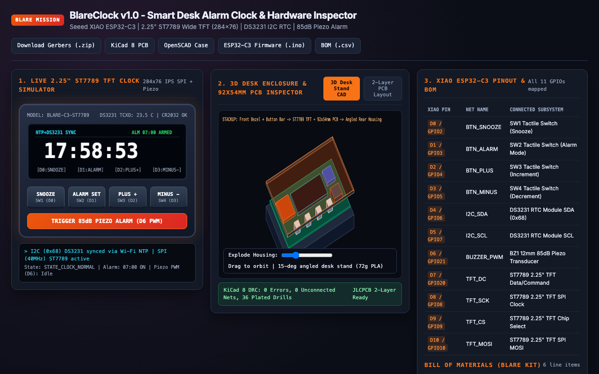

# BlareClock - My XIAO ESP32-C3 Desk Alarm Clock with 2.25" ST7789 TFT & DS3231 RTC

**Try the Live Interactive Clock & Hardware Inspector:** [https://aariv.me/blare-clock/](https://aariv.me/blare-clock/)

I designed and built **BlareClock** for the Hack Club Stardance **BLARE** alarm clock mission. It is a dedicated hardware desk alarm clock powered by a **Seeed Studio XIAO ESP32-C3**, a wide-aspect **2.25" ST7789 SPI TFT bar display (284x76 IPS)**, a **DS3231 temperature-compensated I2C real-time clock (TCXO)** with CR2032 coin-cell backup, a **12mm 85dB passive piezo buzzer**, and **four front-facing Omron tactile push buttons**.

In addition to the complete KiCad 8 schematic, 2-layer carrier PCB (`92.0mm x 54.0mm`), JLCPCB Gerber archive, 15-degree angled OpenSCAD desk enclosure STLs, and ESP32-C3 Arduino firmware, I also built an interactive browser simulator at [https://aariv.me/blare-clock/](https://aariv.me/blare-clock/) where you can test the live 284x76 IPS clock UI, set alarms, trigger the 85dB piezo wake-up melody via Web Audio, inspect the 2-layer PCB traces, and orbit the 3D exploded CAD housing.

## Why I Built This

For years I used my phone as my morning alarm clock, which meant keeping notifications and a glowing screen within arm's reach of my bed every night. On the flip side, cheap digital bedside clocks drift by several minutes a month and lose their time entirely whenever a wall outlet flickers.

I wanted to build a dedicated, zero-distraction hardware desk clock that solves both problems:
1. **Sub-second accuracy that survives power outages**: When `BlareClock` boots, the **XIAO ESP32-C3** connects briefly to Wi-Fi, pulls UTC time from `pool.ntp.org`, and writes that exact timestamp into a battery-backed **DS3231 TCXO real-time clock**. Even if Wi-Fi is down or the USB-C cable is unplugged, the CR2032-backed DS3231 keeps time within `±2 ppm` (`~1 minute per year`) and exposes an onboard die temperature sensor (`±0.25°C` resolution) for the status bar.
2. **Wide-aspect high-contrast digits (`284x76 IPS`)**: Instead of a cramped 128x64 OLED or blinding 7-segment LEDs, I chose a wide 2.25" ST7789 bar TFT so the `HH:MM:SS` readout, armed alarm time, snooze badge, and room temperature fit side by side in crisp typography.
3. **Physical tactile controls & an unmistakable alarm**: Four front-mounted tactile switches (`SNOOZE`, `ALARM SET`, `PLUS +`, `MINUS -`) and a 4-note escalating passive piezo cascade (`C6 -> E6 -> G6 -> C7`) make sure I can operate it by feel at 6:30 AM.

## Features & How It Works Under the Hood

### 1. Five-State Alarm & Snooze State Machine (`firmware/blare_clock.ino`)
I structured the ESP32-C3 firmware around a deterministic 5-state controller:
- **`STATE_CLOCK_NORMAL`**: Renders the live `HH:MM:SS` readout at 10Hz, polls the DS3231 temperature register every 30 seconds, and checks for exact `hour == alarmHour && minute == alarmMin && second == 0` matches when armed. Pressing `SNOOZE` in normal mode toggles `alarmArmed`.
- **`STATE_EDIT_ALARM_HOUR` & `STATE_EDIT_ALARM_MIN`**: Pressing `ALARM SET` highlights the alarm hour field in amber so `PLUS +` and `MINUS -` increment/decrement with wrap-around (`0..23`); pressing `ALARM SET` again shifts to minutes (`0..59`), and a third press commits the new alarm to `Preferences` NVRAM and arms the clock.
- **`STATE_ALARM_RINGING`**: Flashes the wide TFT border in high-contrast crimson and drives the passive piezo buzzer (`GPIO21` LEDC PWM) with an escalating 4-tone square-wave arpeggio (`1046Hz`, `1318Hz`, `1568Hz`, `2093Hz`). Pressing `SNOOZE` enters a 9-minute snooze countdown; pressing `ALARM SET` dismisses the alarm for the day.
- **`STATE_SNOOZING`**: Displays a live `SNOOZE 08:59` countdown badge on the ST7789 screen and automatically re-triggers `STATE_ALARM_RINGING` when the 540-second timer expires.

### 2. 2-Layer 92mm x 54mm Carrier PCB & 15° Angled Enclosure
- **Carrier PCB (`pcb/blare_clock.kicad_pcb`)**: Places the 2.25" ST7789 display module top-center (`Y = 6..34mm`) directly above the four 6mm Omron tactile buttons (`SW1..SW4` at `Y = 45mm`, spaced `18mm` apart) so the entire front face acts as the user interface while the XIAO ESP32-C3, DS3231 RTC module, and 12mm piezo transducer mount cleanly on the rear/inner carrier zone.
- **Angled Desk Housing (`cad/blare_enclosure.scad`)**: Designed with a `15-degree` backward tilt so the display faces your eyes naturally on a desk or nightstand. Includes acoustic louver slots on the rear housing over `BZ1`, a recessed front bezel for the 2.25" glass panel, and a captive 4-button actuator bar (`~72g` total PLA).

## What Was Tricky to Build

1. **Keeping the XIAO ESP32-C3 Boot Strap Pins Safe**:
   On the ESP32-C3, `GPIO8`, `GPIO9`, and `GPIO2` have boot-strapping behaviors if pulled to the wrong logic level during power-on reset. I wired `GPIO8` (`D8`) as `TFT_SCK` and `GPIO9` (`D9`) as `TFT_CS` with external/internal pull-ups so the chip always boots cleanly into normal SPI flash execution mode, even if you hold down `SNOOZE` (`D0 / GPIO2` with internal pull-up) while plugging in USB-C.
2. **Eliminating Display Flicker on the 284x76 ST7789 Panel**:
   Redrawing the full `284x76` SPI framebuffer on every loop iteration caused visible tearing on the seconds counter. In `firmware/blare_clock.ino`, I tracked `lastRenderedSecond` and `lastUiState` so SPI region updates only fire when a digit or state actually changes, keeping the display rock-solid while leaving plenty of CPU headroom for the non-blocking piezo sequencer.

## XIAO ESP32-C3 Pinout & Carrier Wiring

| Seeed XIAO ESP32-C3 Pin | Net Name | Connected Hardware |
| --- | --- | --- |
| `D0 / GPIO2` | `BTN_SNOOZE` | `SW1` Tactile Button (Snooze +9m / Toggle Arm) |
| `D1 / GPIO3` | `BTN_ALARM` | `SW2` Tactile Button (Cycle Set Hour / Set Minute) |
| `D2 / GPIO4` | `BTN_PLUS` | `SW3` Tactile Button (Increment Hour / Minute) |
| `D3 / GPIO5` | `BTN_MINUS` | `SW4` Tactile Button (Decrement Hour / Minute) |
| `D4 / GPIO6 (SDA)` | `I2C_SDA` | `U2` DS3231 RTC Module I2C Data (`0x68`) |
| `D5 / GPIO7 (SCL)` | `I2C_SCL` | `U2` DS3231 RTC Module I2C Clock |
| `D6 / GPIO21` | `BUZZER_PWM` | `BZ1` 12mm 85dB Passive Piezo Transducer |
| `D7 / GPIO20` | `TFT_DC` | `J1` 2.25" ST7789 SPI TFT Data/Command |
| `D8 / GPIO8 (SCK)` | `TFT_SCK` | `J1` 2.25" ST7789 SPI TFT Serial Clock |
| `D9 / GPIO9` | `TFT_CS` | `J1` 2.25" ST7789 SPI TFT Chip Select |
| `D10 / GPIO10 (MOSI)` | `TFT_MOSI` | `J1` 2.25" ST7789 SPI TFT Serial Data In |
| `3V3 / 5V / GND` | Power | Common `3V3` logic/backlight rail and stitched `GND` pour |

## Bill of Materials

| Ref | Qty | Component | Footprint / Package |
| --- | --- | --- | --- |
| `U1` | 1 | Seeed Studio XIAO ESP32-C3 | 14-Pin THT/SMD Module |
| `J1` | 1 | 2.25" ST7789 Wide SPI TFT LCD (284x76 IPS) | 8-Pin 2.54mm Header |
| `U2` | 1 | DS3231 Precision I2C RTC Module + CR2032 | 4-Pin 2.54mm Header |
| `BZ1` | 1 | 12mm 85dB Passive Piezo Buzzer (`PS1240P02BT`) | `MagneticBuzzer_12x9.5mm_P6.5mm` |
| `SW1-SW4` | 4 | 6x6x7mm Omron Tactile Push Buttons (`B3F-1050`) | `SW_PUSH_6mm` |
| `H1-H4` | 4 | M2.5x8mm Screws + M2.5 Brass Heat-Set Inserts | 2.5mm Mounting Holes |

## Repository Structure & How to Explore It

- **Interactive Browser Simulator**: Open [https://aariv.me/blare-clock/](https://aariv.me/blare-clock/) (or open `index.html` locally) to use the live 2.25" ST7789 clock, press `ALARM SET`, `PLUS +`, `MINUS -`, `SNOOZE`, or `TRIGGER 85dB PIEZO ALARM`, inspect the 2-layer PCB copper and silkscreen layers, and orbit the 3D CAD enclosure.
- **KiCad 8 Project & Gerbers**: Open `pcb/blare_clock.kicad_pro` in KiCad 8 to inspect `pcb/blare_clock.kicad_sch` and `pcb/blare_clock.kicad_pcb`. JLCPCB-ready Gerbers are archived at `pcb/gerbers/blare-clock-gerbers.zip`.
- **3D Enclosure CAD**: Open `cad/blare_enclosure.scad` in OpenSCAD or slice `cad/front_bezel.stl`, `cad/rear_housing.stl`, and `cad/button_bar.stl`.
- **ESP32-C3 Firmware**: Open `firmware/blare_clock.ino` in Arduino IDE / PlatformIO with `RTClib` and `Adafruit_ST7789` installed.

## License

MIT.
